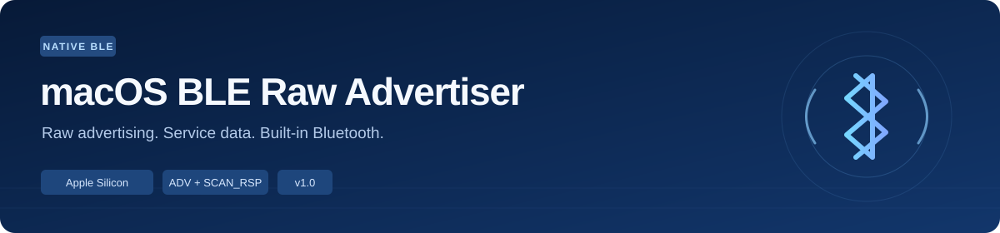
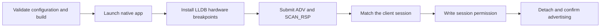

<div align="center">



[](CHANGELOG.md)
[](#requirements)
[](#requirements)
[](#configuration)
[](LICENSE)

English · [简体中文](README.zh-CN.md)

[Quick start](#quick-start) · [Examples](#examples) · [Commands](#commands) · [Workflow](#workflow) · [Configuration](#configuration) · [Troubleshooting](#troubleshooting) · [Development](#development)

</div>

---

macOS BLE Raw Advertiser sends custom Bluetooth Low Energy advertising data and scan responses through the Mac's built-in Bluetooth controller. Configure iBeacon manufacturer data, Service Data and a local name as raw AD structures, then start and stop the advertiser from Finder or Terminal.

The project combines a native CoreBluetooth application with a version-specific LLDB helper. The helper identifies the application's session inside `bluetoothd`, enables its raw-advertising permission with a one-byte session write, and detaches. macOS then handles the advertising request and radio scheduling.

## Features

- **Raw ADV and SCAN_RSP:** configure each buffer independently, with up to 31 bytes per buffer.
- **Service Data:** send service-specific bytes alongside an iBeacon payload or a local name.
- **Readable configuration:** JSON payload files with hex normalization, AD-length checks and a decoded preview.
- **Session-specific authorization:** match the client PID, executable path, creation time and user before writing its session permission.
- **Version checks:** verify the system build, daemon SHA-256, loaded module UUID and permission-check instructions.
- **Background operation:** a standalone app continues advertising after the launcher closes.
- **Lifecycle controls:** start, stop, status and environment checks, with configuration fingerprints and process ownership checks.
- **Reproducible project:** source code, platform profile, offline tests, build script and release packaging.

## Requirements

| Component | Supported configuration |
| --- | --- |
| Mac | Apple Silicon with built-in Bluetooth |
| macOS | **26.4, build 25E246** |
| Development tools | Apple Command Line Tools or Xcode, including Clang, LLDB and Python 3.9+ |
| Application permissions | Bluetooth and access to the project folder |
| System access | Administrator authorization and SIP debugging restrictions configured for system-process debugging |

The included [platform profile](profiles/macos-26.4-25E246-arm64.json) pins this build to a specific `bluetoothd` SHA-256, arm64e UUID and instruction sequence. Matching checks establish the environment for the session experiment.

## Quick start

### 1. Build and choose a payload

Extract the release archive or clone the project into a fixed, writable directory, then open Terminal there.

```sh
# Install Apple's development tools when setting up a new machine
xcode-select --install

# Build the arm64 application
./scripts/build.sh

# Create your local configuration
cp examples/ibeacon-service-data.json config.json

# Inspect the payload and environment
python3 scripts/cli.py validate
python3 scripts/cli.py doctor
```

A release archive includes the source and an ad-hoc signed application. The launcher checks the source fingerprint and rebuilds when the application sources change. Python scripts use the standard library and Apple's LLDB runtime.

### 2. Configure system debugging

The session helper uses system-process debugging access. To prepare an Apple Silicon Mac:

1. Shut down, hold the power button until startup options appear, then choose **Options → Continue**.
2. Open **Utilities → Terminal** in Recovery.
3. Run:

   ```sh
   csrutil enable --without debug
   ```

4. Restart macOS and run `python3 scripts/cli.py doctor` again.

This setting enables debugging access to protected system processes. The setup and restoration commands are part of the experiment's operating procedure. Apple's [Runtime Protections](https://developer.apple.com/library/archive/documentation/Security/Conceptual/System_Integrity_Protection_Guide/RuntimeProtections/RuntimeProtections.html) describes the underlying protection.

### 3. Start advertising

Double-click **start.command**, or run:

```sh
python3 scripts/cli.py start
```

Allow `RawBLEAdvertiser` to use Bluetooth and access the project folder when macOS prompts. Approve the administrator dialog for the session helper. Successful startup prints:

```text
Raw advertising accepted. Verify the payload with an active BLE scanner.
ADV 30 bytes / SCAN_RSP 19 bytes
```

The application keeps running after the launcher exits. Double-click **status.command** to check it, and **stop.command** to end the session.

## Examples

| Task | Command |
| --- | --- |
| Send the local configuration | `python3 scripts/cli.py start` |
| Send the iBeacon + Service Data example | `python3 scripts/cli.py start --config examples/ibeacon-service-data.json` |
| Send the compact Service Data example | `python3 scripts/cli.py start --config examples/service-data.json` |
| Decode and validate a configuration | `python3 scripts/cli.py validate --config examples/service-data.json` |
| Read machine-readable status | `python3 scripts/cli.py status --json` |
| Check the current platform | `python3 scripts/cli.py doctor --json` |
| End the advertising session | `python3 scripts/cli.py stop` |

The public iBeacon example advertises:

| Field | Value |
| --- | --- |
| Complete local name | `RawBLELab` |
| iBeacon UUID | `12345678-1234-5678-1234-56789ABCDEF0` |
| Major / Minor | `1` / `1` |
| Measured Power | `-69` |
| Service UUID | `0xFFF0` |
| Service Data | `01020304` |

### Check reception with a phone

1. Scan before startup to establish a baseline for the test identifiers.
2. Start the advertiser and use an **active BLE scanner** to locate `RawBLELab`.
3. Inspect the iBeacon fields and the `0xFFF0` service bytes. Active scanning obtains the scan response containing the name and Service Data.
4. Export the full scan record with its reception time, then stop the advertiser and compare whether the entry continues updating.

The `on` state records successful session authorization, debugger detach and the system's advertising callback. Export the scanner record to inspect the bytes received by the phone.

## Commands

| Command | Purpose | Finder entry |
| --- | --- | --- |
| `start [--config FILE]` | Validate the environment and start one advertising session | `start.command` |
| `stop` | Stop the client identified by its executable path and creation time | `stop.command` |
| `status [--json]` | Read current client state | `status.command` |
| `doctor [--json]` | Check hardware, build, daemon hash, LLDB and debugging access | `check.command` |
| `validate [--config FILE]` | Normalize hex and decode AD structures | Terminal |

Configuration selection is `--config FILE`, then `config.json`, then `examples/ibeacon-service-data.json`.

Starting the same configuration reuses the current process. To change a running payload, stop the existing session and start the new configuration. After sleep, a Bluetooth reset or a daemon restart, check the status and start a fresh session as needed.

## Configuration

```json
{
  "name": "RawBLELab",
  "description": "iBeacon + Service Data example",
  "advertisingDataHex": "0201061AFF4C0002151234567812345678123456789ABCDEF000010001BB",
  "scanResponseDataHex": "0716F0FF010203040A09526177424C454C6162"
}
```

| Field | Meaning |
| --- | --- |
| `name` | Configuration label; checked against Complete Local Name bytes when present |
| `description` | Human-readable description |
| `advertisingDataHex` | Primary advertising AD structures, 1–31 bytes |
| `scanResponseDataHex` | Scan-response AD structures, 0–31 bytes; use `""` for an empty buffer |

Hex accepts whitespace and either letter case. `validate` checks AD boundaries, Flags placement, Service Data UUID lengths, Company ID length, UTF-8 names and the relationship between the name label and payload bytes. It produces a normalized payload and configuration fingerprint.

An AD structure is `[Length][Type][Data]`. `Length` includes the type and data bytes. A 16-bit Service Data UUID uses little-endian encoding: `0xFFF0` appears as `F0 FF`. Update the AD length when changing a field's size, and provide the significant bytes of each buffer.

The default example splits into:

```text
ADV       30 bytes: Flags + iBeacon manufacturer data
SCAN_RSP  19 bytes: Service Data + Complete Local Name
```

Phone exports often combine primary advertising and scan-response data into one `rawHex` value. Split those structures into the two configured buffers. The transmitter address and radio scheduling are managed by macOS.

## Workflow



1. Validate the configured AD structures and current platform profile.
2. Launch the native app through LaunchServices and wait for Bluetooth readiness.
3. With administrator authorization, attach LLDB and verify the loaded daemon's UUID and instructions.
4. Install hardware breakpoints at the raw-advertising permission checks, then release the app's request.
5. Match the client session and write its permission byte, recording the original value and readback.
6. Remove breakpoints, detach, and publish the result. The app correlates the result with its PID, token and payload fingerprint before reporting `on`.

## Architecture

| Module | Files | Responsibility |
| --- | --- | --- |
| Native application | `src/main.m`, `src/Info.plist` | CoreBluetooth, background lifecycle, state and ownership checks |
| Control | `scripts/cli.py`, `scripts/control.sh` | Configuration selection, environment checks, startup and shutdown |
| Payload parser | `scripts/payload.py` | Hex normalization, AD validation and decoded previews |
| Session helper | `scripts/session_gate.py`, `scripts/gate-root.sh` | Client identity, hardware breakpoints, permission write and debugger cleanup |
| Build profile | `profiles/*.json` | Daemon hash, module UUID, instructions and session layout |
| Build and release | `scripts/build.sh`, `scripts/package.py` | Compilation, application signing, ZIP and checksum generation |

The session experiment writes a permission byte in the matching client's runtime object. Stopping the application ends that XPC session. LLDB attach and breakpoint handling briefly pause the shared Bluetooth daemon. Details, offsets and lifecycle behavior are documented in [architecture.md](docs/architecture.md).

The related work and the contribution of this implementation are described in [research.md](docs/research.md).

## Runtime files

```text
.runtime/
├── request.json       Normalized payload and launch token
├── state.json         Client PID, creation time, payload fingerprint and phase
├── gate-result.json   Permission-write and detach result
├── advertiser.log     Native application output
└── gate.log           LLDB helper output
```

The project uses `.gitignore` and the release packager to keep local configuration, runtime files and `private/` material in the working copy. Review a diagnostic excerpt before sharing it, retaining the fields needed to reproduce the issue.

## Troubleshooting

| Symptom | Next step |
| --- | --- |
| Build or daemon hash mismatch | Compare `doctor --json` with the included platform profile |
| Development tool lookup fails | Install Command Line Tools; check `xcrun --find lldb` and `xcrun --find python3` |
| Bluetooth startup times out | Check the Bluetooth switch and the app's Bluetooth/folder permissions |
| Administrator authorization or gate fails | Read `.runtime/gate.log` and retry after resolving the reported check |
| Status reports `error` or `off` | Inspect `.runtime/advertiser.log`, then start a fresh session |
| Another payload is running | Stop it before starting the new configuration |
| Build reports an active client | Stop the application, then rebuild |
| Scanner shows the iBeacon fields | Inspect active scanning, scan-response visibility and the scanner's cache |

### Restore the usual debugging protection

Stop the advertiser, enter Recovery, run the following command, then restart:

```sh
csrutil enable
```

The administrator helper restores the previous DevToolsSecurity setting on normal exit. Check its current state with `DevToolsSecurity -status` after an interrupted experiment. Apple's [SIP configuration documentation](https://developer.apple.com/documentation/security/disabling-and-enabling-system-integrity-protection) covers the system setting.

## Development

```sh
# Run payload, memory-policy and packaging tests
./scripts/test.sh

# Compile and sign the native application
./scripts/build.sh

# Produce a source + application ZIP, SHA256SUMS and ZIP checksum
python3 scripts/package.py
```

Offline tests cover the 31-byte boundary, malformed AD structures, client matching, permission values, read/write failures, byte-level write scope and release-file selection.

```text
src/          Native application
scripts/      Control, payload checks, helper, build and packaging
profiles/     Version-specific daemon profiles
examples/     Public test payloads
tests/        Offline tests
docs/         Architecture and related work
build/        Local application build
.runtime/     Local advertising session
private/      Local working material
```

See [CONTRIBUTING.md](CONTRIBUTING.md) for profile adaptation and test expectations, and [CHANGELOG.md](CHANGELOG.md) for release history.

## License

Created by [ChengDSYJ-Studio](https://github.com/ChengDSYJ-Studio). Licensed under [MIT](LICENSE).
